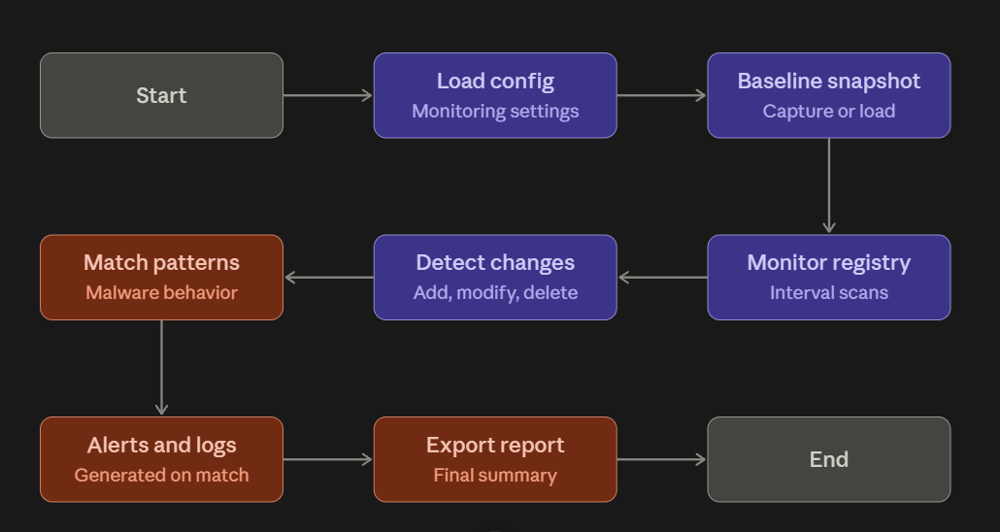
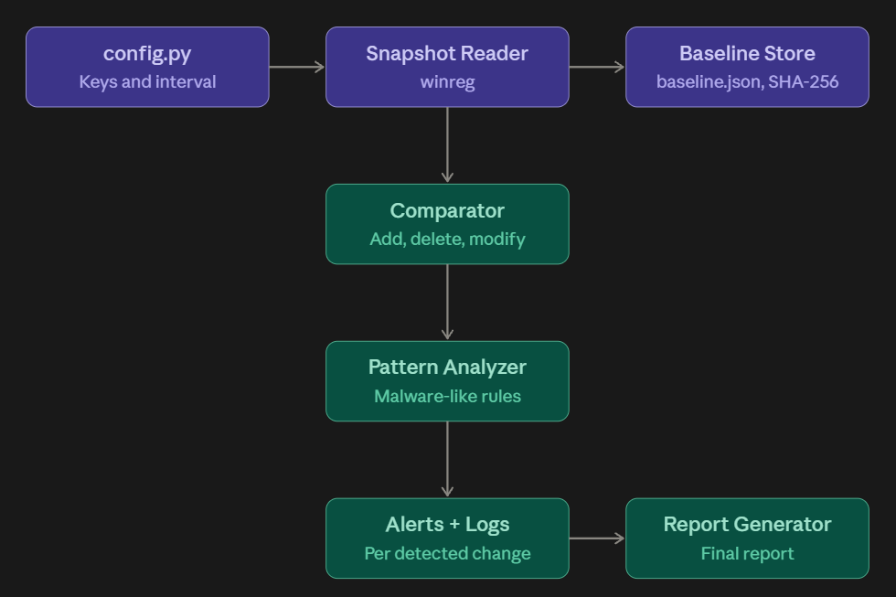
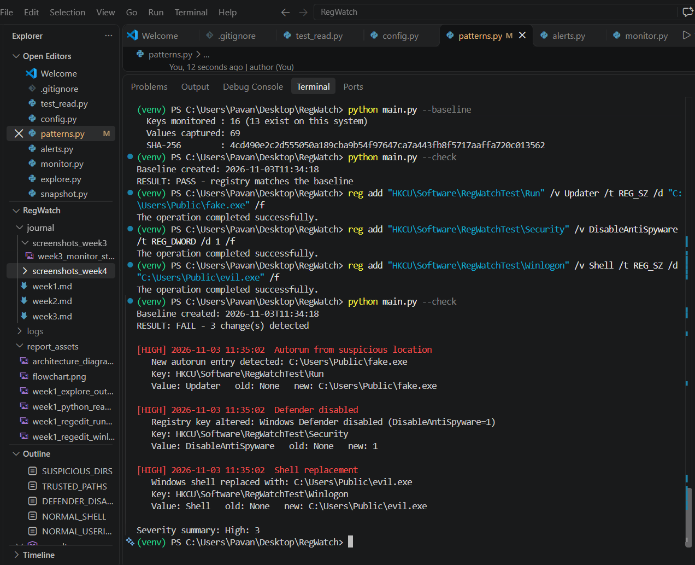
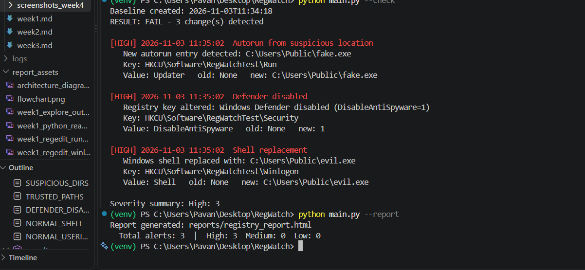
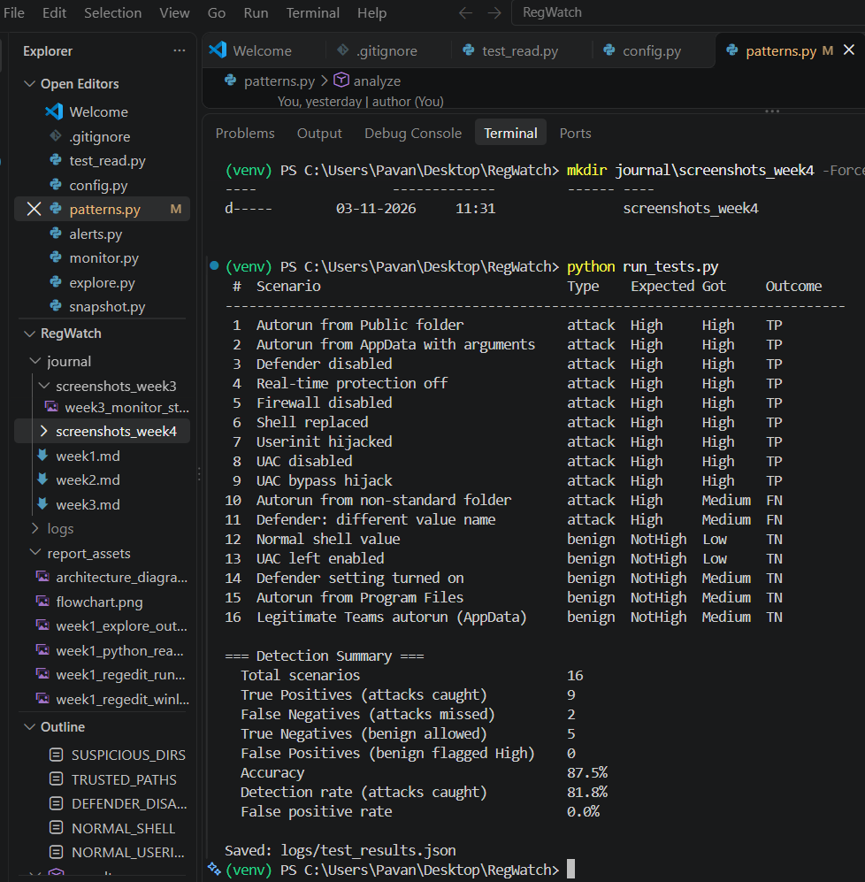

<h1 align="center">RegWatch</h1>
<p align="center"><b>Windows Registry Change Monitoring System</b></p>
<p align="center">
  Python · winreg · hashlib · Blue Team · Endpoint Monitoring
</p>

RegWatch is a Python toolkit that watches sensitive Windows Registry keys, detects unauthorized or malware-like changes, verifies registry integrity against a trusted baseline, and produces alerts and reports.

**Quick links:** [Sample report (PDF)](reports/registry_report.pdf) · [Architecture](#architecture) · [Usage](#usage) · [Results](#results)

---

## At a Glance

| | |
|---|---|
| **Purpose** | Detect registry-based persistence and tampering |
| **Detection methods** | Baseline comparison, autorun monitoring, malware-pattern rules |
| **Output** | Severity-rated alerts, timestamped logs, HTML/PDF report |
| **Monitoring mode** | Polling (configurable interval) |
| **Test accuracy** | 87.5% on 16 simulated scenarios |
| **Safe testing** | All simulations run on a harmless test key |

**Click any section below to expand it.**

---

<details>
<summary><b>1. Background: why the registry matters</b></summary>


&nbsp;


The Windows Registry is a hierarchical database that holds system settings, startup locations, user preferences, and application behavior. Windows reads it constantly, which makes it a high-value target.

Attackers abuse it to:

- **Stay installed (persistence):** add a program to a Run key so it starts at every login
- **Disable protection:** set values that switch off Windows Defender or the firewall
- **Take over the desktop:** replace the Winlogon `Shell` value so their program launches instead of `explorer.exe`
- **Gain admin rights quietly:** disable UAC or hijack a trusted program's command key
- **Change ransomware or policy settings** that survive a reboot

An unauthorized registry change can therefore indicate malware, privilege misuse, or a policy violation. RegWatch gives a defender early warning of these changes.

</details>

<details>
<summary><b>2. Core concepts</b></summary>


&nbsp;


| Concept | Explanation |
|---|---|
| **Hives** | Top-level sections: `HKCU` (current user) and `HKLM` (whole machine) |
| **Keys and values** | A key is like a folder, a value is a named item inside it |
| **Value types** | `REG_SZ` (text), `REG_EXPAND_SZ`, `REG_DWORD` (number, often 0 or 1), `REG_BINARY` |
| **Run / RunOnce keys** | Programs listed here start automatically at login |
| **Baseline** | A snapshot of the registry taken while the system is trusted |
| **Integrity checking** | Comparing the current state to the baseline to find differences |
| **Checksum (SHA-256)** | A fingerprint of the baseline file, used to detect tampering with the baseline itself |
| **Polling** | Re-reading the registry at fixed intervals to look for new changes |
| **Severity** | A rating (High, Medium, Low) that shows how dangerous a change is |

</details>

<details>
<summary><b>3. Monitored keys and malware behaviors</b></summary>


&nbsp;


| Category | Registry location | What attackers do | RegWatch rule |
|---|---|---|---|
| Autorun | `...\CurrentVersion\Run`, `RunOnce` (HKCU and HKLM) | Add their program to start at login | New entry flagged; High if the program runs from AppData, Temp, Downloads, Public, or ProgramData |
| Security tools | Windows Defender and Firewall policy keys | Set `DisableAntiSpyware`, `DisableRealtimeMonitoring`, or `EnableFirewall=0` | High when a disabling value appears |
| Shell replacement | `Winlogon\Shell`, `Userinit` | Replace `explorer.exe` with their program | High when the value is not the Windows default |
| UAC | `Policies\System\EnableLUA` | Set to 0 to turn UAC off | High |
| UAC bypass | `Classes\ms-settings\Shell\Open\command` | Hijack a trusted program to run code without a prompt | High when the key is created or set |

</details>

<details>
<summary><b>4. How it works (workflow)</b></summary>


&nbsp;


1. **Load configuration:** read the list of sensitive keys from `config.py`
2. **Create the baseline:** snapshot every monitored key and save it with a SHA-256 checksum
3. **Monitor:** take a new snapshot, once or every few seconds
4. **Detect changes:** compare against the baseline and label each difference as ADDED, DELETED, or MODIFIED (also whole keys appearing or disappearing)
5. **Analyze:** match each change against malware-behavior rules and assign a severity
6. **Alert and log:** print a colored alert and save a timestamped record with key path, old value, and new value
7. **Report:** generate a consolidated change-analysis report



</details>

<details id="architecture">
<summary><b>5. Architecture</b></summary>


&nbsp;




| Module | Responsibility |
|---|---|
| `config.py` | Defines which keys are monitored and their category |
| `snapshot.py` | Reads registry keys into one dictionary using `winreg` |
| `baseline.py` | Saves and loads the baseline, verifies its SHA-256 checksum |
| `compare.py` | Finds added, deleted, and modified values |
| `patterns.py` | Malware-behavior rules, severity, and allowlist |
| `alerts.py` | Console alerts and the JSON alert log |
| `monitor.py` | Polling loop that reports each new change once |
| `report.py` | Builds the HTML change-analysis report |
| `run_tests.py` | Automated detection tests with TP/FN/TN/FP scoring |
| `main.py` | Command-line entry point |

</details>

<details>
<summary><b>6. Features</b></summary>


&nbsp;


- Monitors `Run` and `RunOnce` in both HKCU and HKLM
- Detects Defender or firewall disabling, shell replacement, UAC changes, and UAC bypass keys
- Baseline integrity checker with **tamper detection on the baseline file itself**
- Distinguishes added, deleted, and modified values
- Severity-rated alerts with timestamp, key path, old value, and new value
- Live monitoring mode with a configurable interval
- Optional Task Scheduler automation for scheduled checks
- Consolidated HTML/PDF change-analysis report
- Automated test suite that measures detection accuracy
- Safe simulation using a harmless test key

</details>

<details id="usage">
<summary><b>7. Usage</b></summary>


&nbsp;


```
python main.py --baseline                 # capture a trusted baseline
python main.py --check                    # one-time integrity check
python main.py --monitor --interval 10    # live monitoring every 10 seconds
python main.py --report                   # generate the change report
python run_tests.py                       # run the detection test suite
```

**Requirements:** Windows and Python 3. No third-party packages are needed, since `winreg`, `hashlib`, `json`, and `argparse` are built in.

**Try it safely:**

```
reg add "HKCU\Software\RegWatchTest\Run" /v Updater /t REG_SZ /d "C:\Users\Public\fake.exe" /f
python main.py --check
reg delete "HKCU\Software\RegWatchTest" /f
```

All simulations use `HKCU\Software\RegWatchTest`. The paths are only text, and no files are created. Reading `HKLM` keys works without administrator rights, but writing to them would need it, and RegWatch never writes.

</details>

<details>
<summary><b>8. Example output</b></summary>


&nbsp;


```
[HIGH] 2026-11-03 11:30:12  Autorun from suspicious location
   New autorun entry detected: C:\Users\Public\fake.exe
   Key: HKCU\Software\RegWatchTest\Run
   Value: Updater   old: None   new: C:\Users\Public\fake.exe

[HIGH] 2026-11-03 11:30:12  Defender disabled
   Registry key altered: Windows Defender disabled (DisableAntiSpyware=1)

RESULT: FAIL - 3 change(s) detected
Severity summary: High: 3
```

**Integrity check detecting changes**



**Report generation**



</details>

<details id="results">
<summary><b>9. Testing and results</b></summary>


&nbsp;


A test suite applies 16 scenarios to the safe test key: 11 attacks and 5 benign changes. Each result is classified as a true positive, false negative, true negative, or false positive.

| Metric | Before tuning | After tuning |
|---|:---:|:---:|
| True Positives (attacks caught) | 9 | 9 |
| False Negatives (attacks missed) | 2 | 2 |
| True Negatives (benign allowed) | 4 | 5 |
| False Positives (benign flagged) | 1 | 0 |
| **Accuracy** | **81.3%** | **87.5%** |

**What was found and fixed**

- **False positive (fixed):** a legitimate Microsoft Teams autorun from AppData was flagged High. An allowlist of trusted application folders removed it.
- **False negative (open):** an autorun from a normal-looking folder (`C:\Tools\evil.exe`) scored only Medium.
- **False negative (open):** a Defender value name outside the rule list (`DisableRoutinelyTakingAction`) was missed.



</details>

<details>
<summary><b>10. Limitations and future work</b></summary>


&nbsp;


**Limitations**

- Polling can miss a change that is made and reversed between two checks
- Rules only cover known patterns, so new techniques or unlisted value names can be missed
- The folder-based rule and the allowlist can be bypassed, for example by malware placed in a folder named `Teams`
- The baseline assumes the system was clean when captured
- Only a subset of registry keys is monitored
- Testing was simulated on a test key and not against real malware

**Future improvements**

- Event-driven monitoring instead of polling
- Digital-signature and file-reputation checks for autorun programs
- A database for change history and trends
- Wider key coverage (services, scheduled tasks, IFEO, AppInit_DLLs)
- Email or webhook alerts

</details>

<details>
<summary><b>11. Project structure</b></summary>


&nbsp;


```
RegWatch/
├── main.py              command-line entry point
├── config.py            monitored keys
├── snapshot.py          registry reader
├── baseline.py          baseline and checksum
├── compare.py           change detection
├── patterns.py          malware rules
├── alerts.py            alert output and log
├── monitor.py           live monitoring
├── report.py            report generator
├── run_tests.py         detection tests
├── reports/             sample report
├── journal/             weekly practical journals
├── report_assets/       diagrams
└── requirements.txt
```

</details>

---

## Learning Outcomes

- How the Windows Registry is structured and which keys matter for security
- How malware achieves persistence and tampers with security settings
- How defenders build baseline-based integrity monitoring
- Scripting registry auditing with Python's `winreg`
- Measuring a detection system with true and false positives and negatives

## Tech Stack

Python 3 · `winreg` · `hashlib` (SHA-256) · `argparse` · JSON · Git/GitHub

---

<sub>Built as a blue-team endpoint monitoring project. All testing was performed on a harmless test key.</sub>