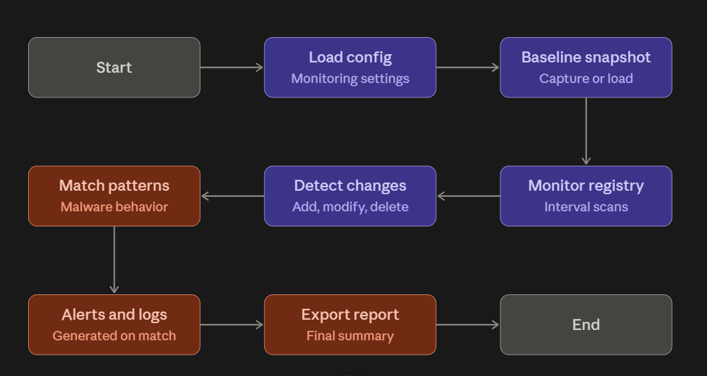
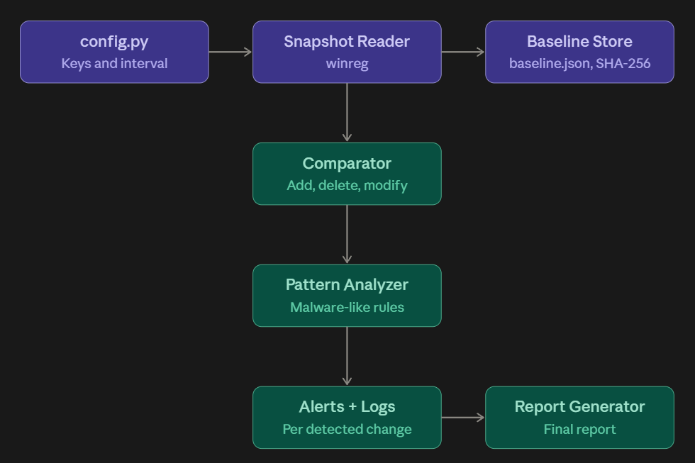
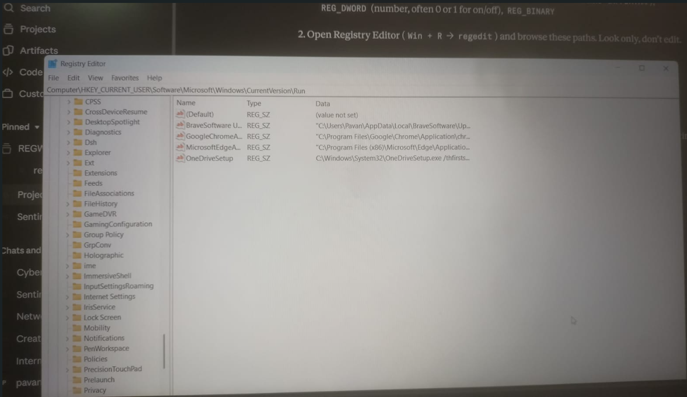
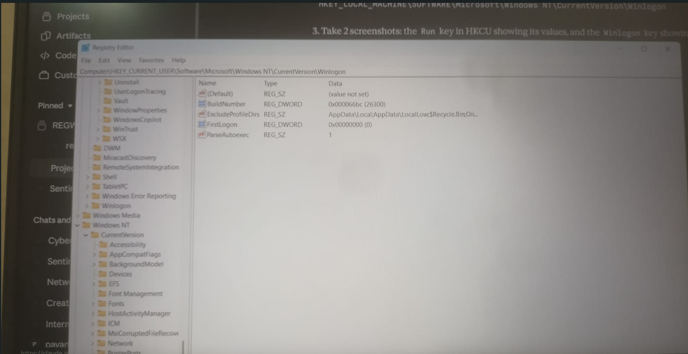
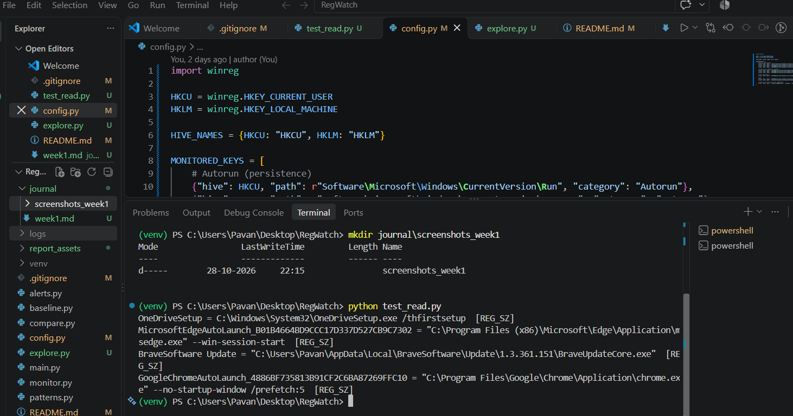
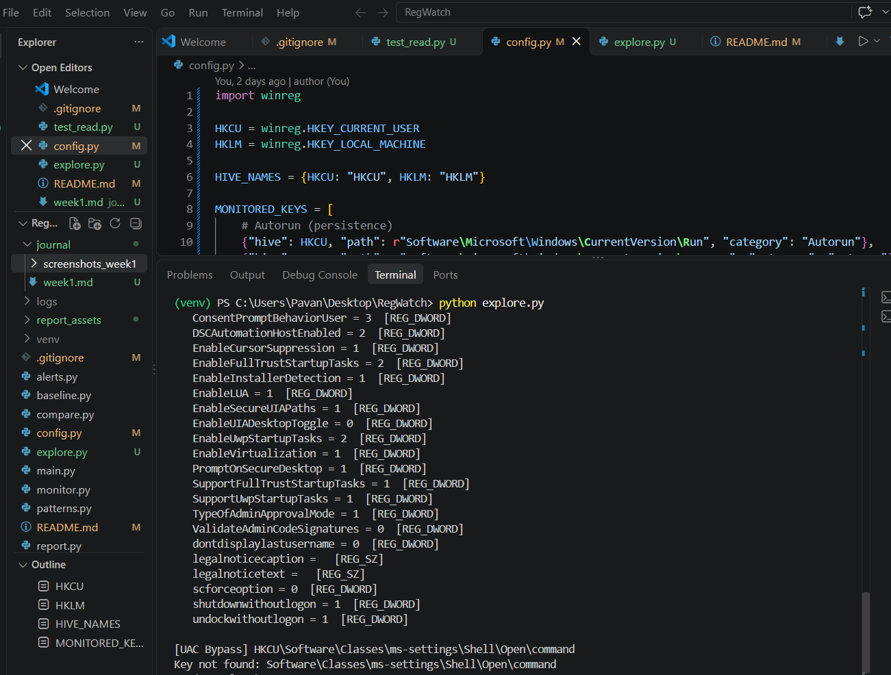

# Week 1: Foundation, Registry Basics and Architecture

## Purpose
 To understand how malware exploits Windows Registry keys and values to establish persistence, modify security settings, and potentially disable protective mechanisms. This knowledge helps in developing RegWatch to monitor registry changes, detect suspicious activity, and improve Windows system security.

## Tools Used
Python, winreg module, Registry Editor (regedit), VS Code, Git

## Steps Performed
1. Set up the project, virtual environment, and Git repository
2. Studied registry hives, keys, values, and value types
3. Explored autorun and Winlogon keys in Registry Editor
4. Read registry values from Python using winreg
5. Defined the list of sensitive keys to monitor in config.py
6. Designed the flowchart and architecture diagrams
7. Researched how malware uses the registry

## Observations
- Malware may modify specific Windows Registry keys and values to establish persistence, alter security settings, or attempt to weaken protection mechanisms. Monitoring unauthorized registry modifications can help RegWatch identify suspicious activity and potential security threats.s
- 

## Registry Concepts Learned
 During this learning session, I explored how the Windows Registry works and how malware can misuse registry keys and values to perform malicious activities. I learned how attackers may modify registry settings to maintain persistence, allowing malware to run again after a system restart or user login.

I also learned about the role of registry keys and values in configuring Windows applications and security settings. Additionally, I explored how spyware may use registry modifications to remain active and how security tools can help detect and remove such threats.

I studied User Account Control (UAC) and its role in requesting permission for actions that require administrator privileges. I also learned about security tampering, including how attackers may attempt to disable security protections and why it is important to monitor suspicious changes. 

## How Malware Uses the Registry
  The Windows Registry is a database that stores system and application settings. Because Windows reads it constantly, including at startup and login, malware targets it for five main purposes: surviving reboots, disabling security, taking over the desktop, and getting higher privileges without the user noticing. It is also attractive to attackers because most of these changes need no special tools, only a few key edits.

1. Persistence

Malware adds an entry to the Run or RunOnce keys so it starts automatically at every login (or once, for RunOnce). Without this, the malware would stop working after a restart. Paths pointing to AppData or Temp are suspicious, since legitimate software is normally installed in Program Files.

2. Security Tampering

Malware sets values such as DisableAntiSpyware or DisableRealtimeMonitoring to 1 in the Defender policy keys. This switches off the antivirus so the malware can run without being detected or removed. These values normally don’t exist, so their appearance is a warning sign.

3. Shell Replacement

The Shell and Userinit values under Winlogon tell Windows which programs to launch at login. Malware replaces or appends to them (default: explorer.exe and userinit.exe) so that its own program runs every time a user logs in. Any value other than the default is suspicious.

4. UAC Bypass

Some trusted Windows programs run with high privileges automatically, with no prompt. Malware creates the key Classes\ms-settings\Shell\Open\command and stores its own command there. When the trusted program starts, it runs the malware with elevated rights. This key does not exist on a clean system, so its presence is enough to raise an alert.

5. UAC Disable

Setting EnableLUA to 0 under Policies\System turns off User Account Control completely. After a reboot, programs can run with full privileges and Windows never asks for permission. The normal value is 1, so any 0 should be flagged.

## Interpretation

Unauthorized changes to Windows Registry keys and values may indicate suspicious activity, such as malware persistence or attempts to tamper with security settings. RegWatch can monitor these changes and help identify potential threats for further investigation.

## Diagrams

## Screenshots

