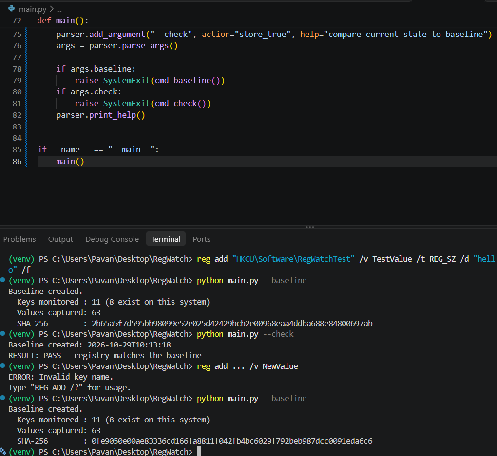
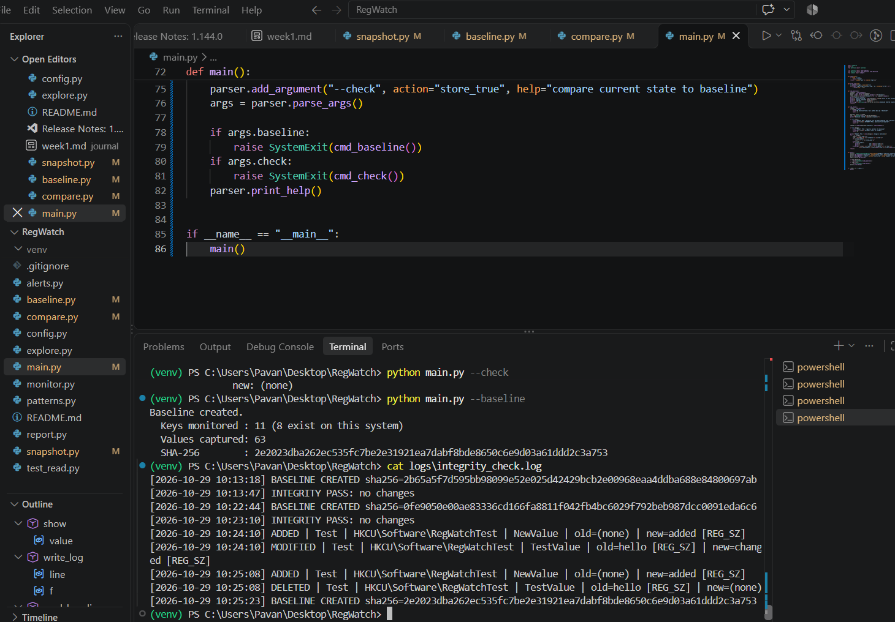
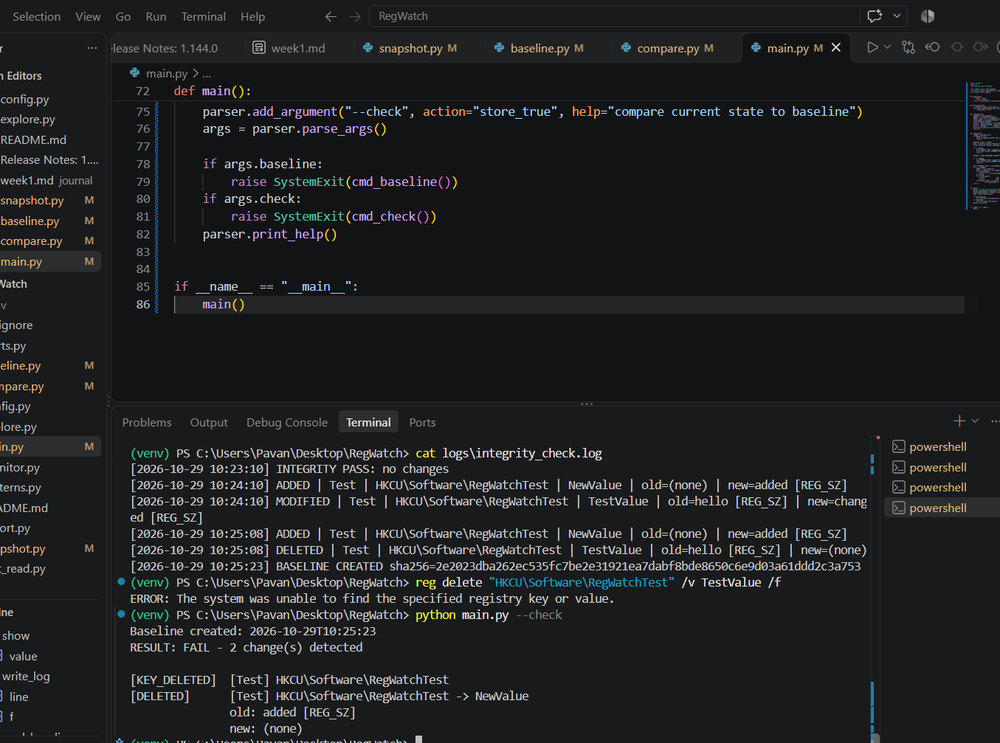
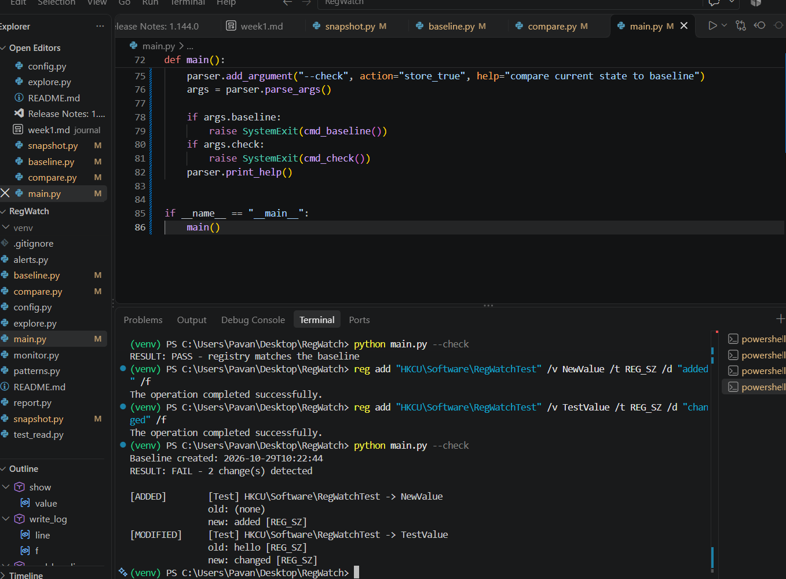
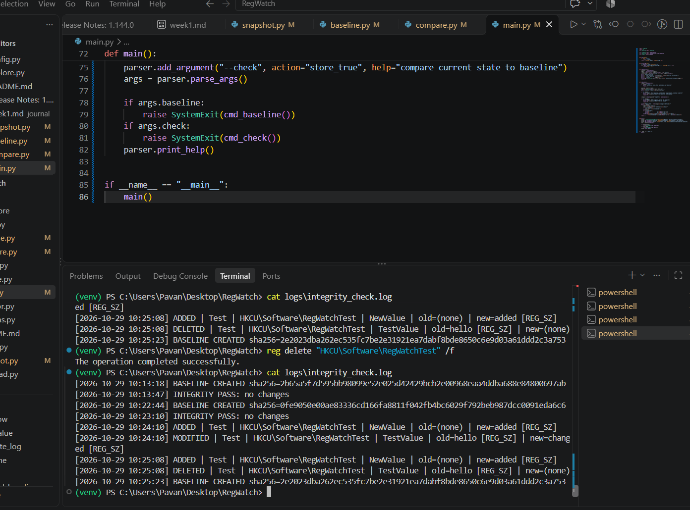

# Week 2: Baseline and Integrity Checker

## Purpose
Build the core of the registry monitor: capture a baseline snapshot of sensitive registry keys, protect it with a checksum, and detect additions, deletions, and modifications by comparing the current state against it.

## Tools Used
Python, winreg, hashlib (SHA-256), json, argparse, Registry Editor, VS Code, Git

## Steps Performed
1. Built snapshot.py to read all monitored keys into a dictionary
2. Built baseline.py to save the snapshot as JSON with a SHA-256 checksum
3. Built compare.py to detect added, deleted, and modified values
4. Built main.py with --baseline and --check commands
5. Tested using a safe test key (HKCU\Software\RegWatchTest)
6. Tested tamper detection by editing the baseline file

## Observations
- Baseline result: Keys Monitored :11 , values captured :63 
- Check with no changes:old :add [REG_SZ] ,new :(none)
- Added value
- Modified value
- Deleted value
- Tampered baseline

## Interpretation
 When an attacker attempts to modify the Windows Registry, RegWatch monitors the registry keys and values and captures their current state in snapshots. The baseline represents the original, trusted registry state. RegWatch compares newly captured snapshots with the baseline or previous snapshots to identify changes, such as added, modified, or deleted registry keys and values.

If any unexpected or unauthorized changes are detected, RegWatch can flag them as suspicious activity for further investigation. This helps identify possible security threats, such as malware attempting to establish persistence or tamper with system settings.

## Limitations Noticed
Limited Registry Monitoring: RegWatch monitors only the registry keys and values configured in the project. Changes outside the monitored areas may go undetected.

Difficulty Identifying Attacks: Not every registry change is malicious. RegWatch may flag legitimate changes made by Windows or installed applications as suspicious.

Baseline Dependency: The system depends on a trusted baseline for comparison. If the baseline is modified or created from an already compromised registry, suspicious changes may not be detected correctly.

Limited Real-Time Detection: If RegWatch checks the registry only at scheduled intervals or during manual scans, changes occurring between scans may not be detected immediately.

## Screenshots

