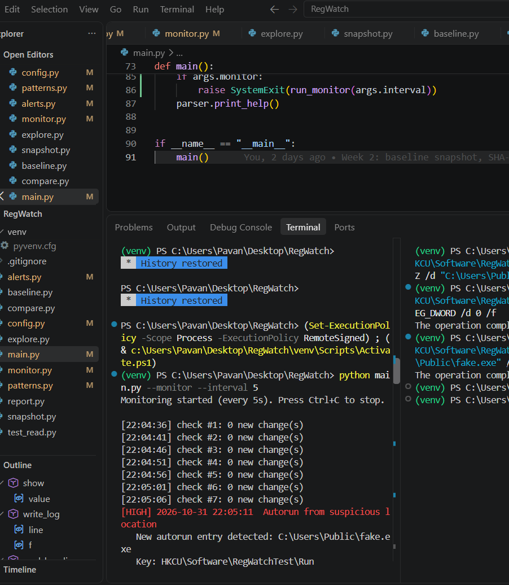
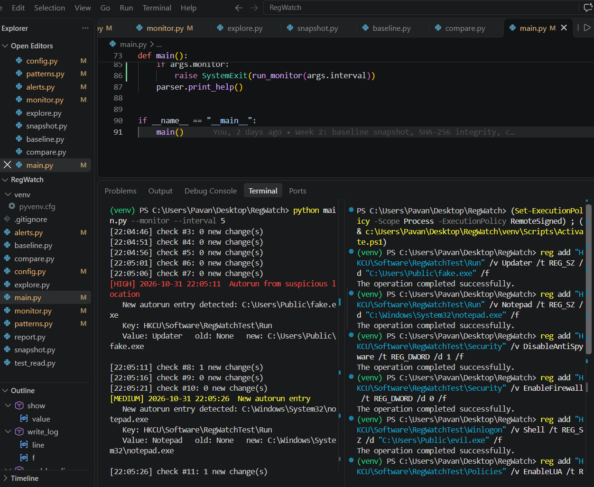
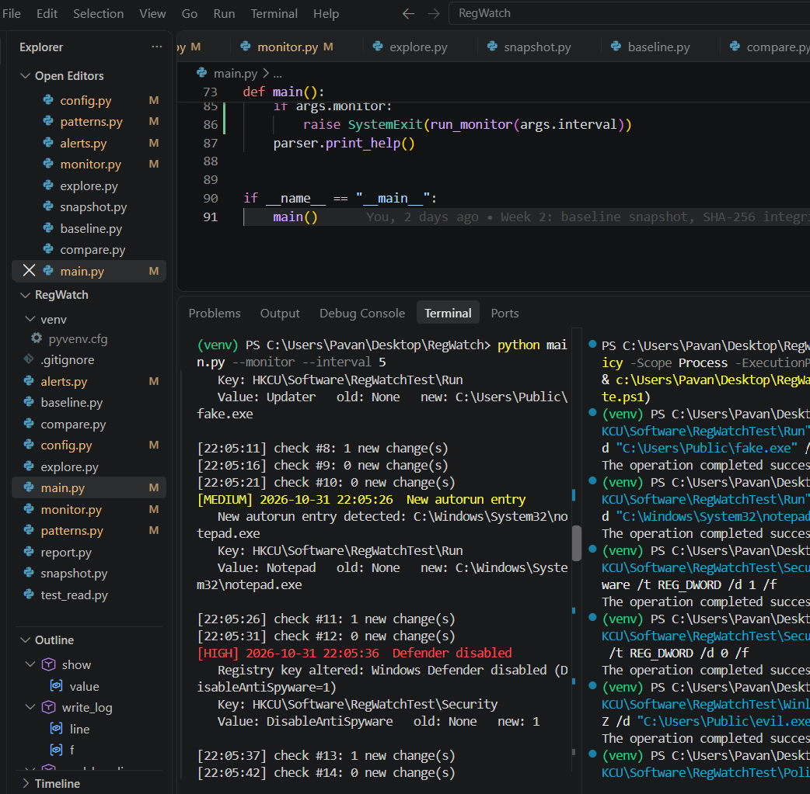
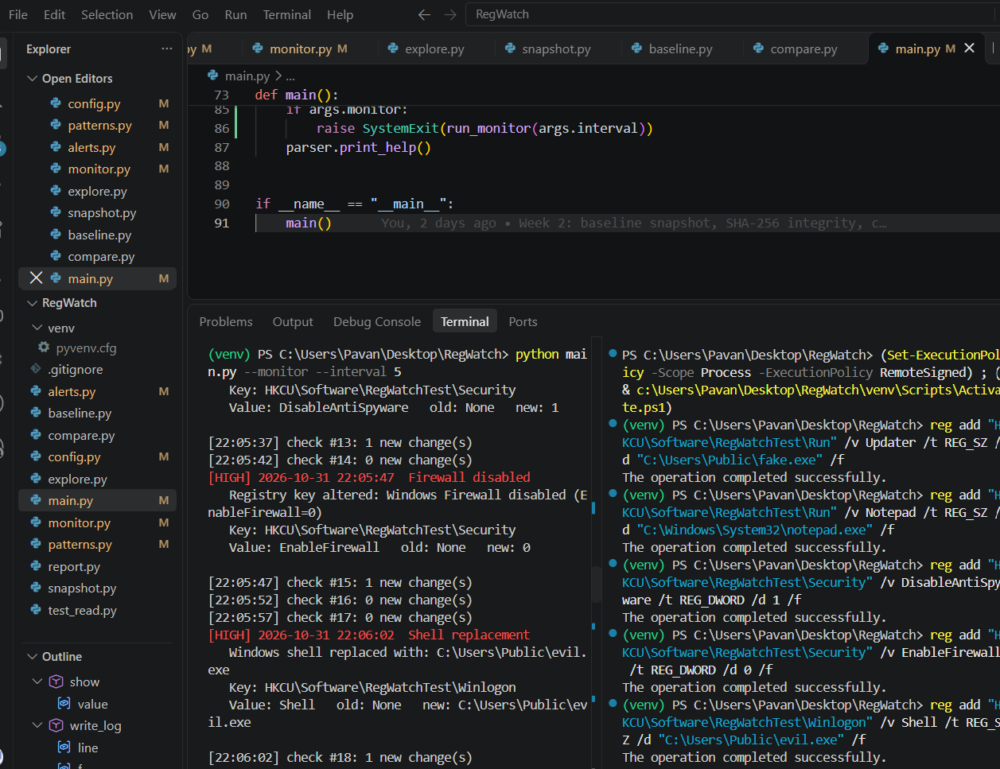
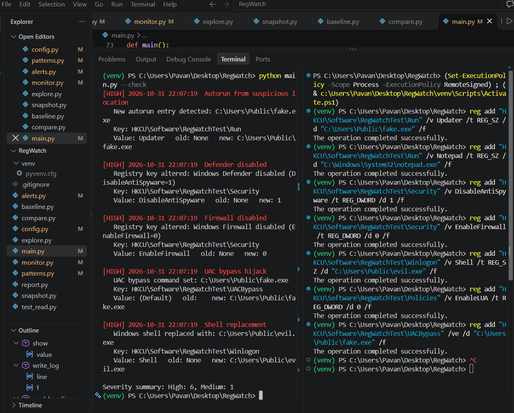
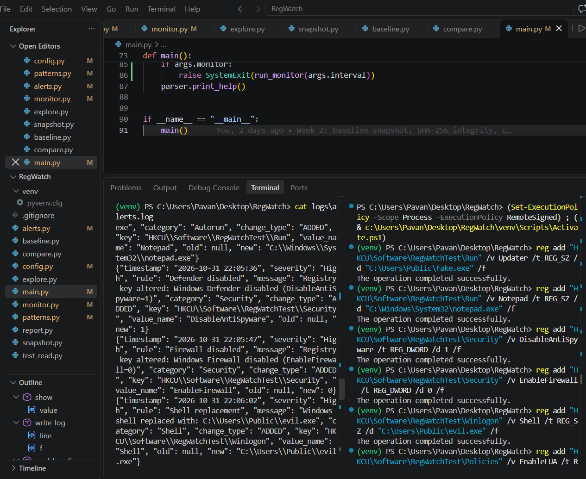

# Week 3: Autorun Monitoring, Malware Patterns and Alerting

## Purpose
Move from detecting any change to recognizing dangerous changes. Classify changes by malware behavior, raise severity-rated alerts, and monitor the registry live.

## Tools Used
Python, winreg, json, argparse, reg.exe (to simulate changes), Registry Editor, VS Code, Git

## Steps Performed
1. Added safe simulation keys with real categories to config.py
2. Built patterns.py with rules for autorun, Defender, firewall, shell, UAC, and UAC bypass
3. Built alerts.py to print colored alerts and write JSON logs
4. Built monitor.py, a polling loop that reports only new changes
5. Extended main.py with --monitor and --interval
6. Simulated seven malware-like changes on a harmless test key

## Detection Rules Implemented
| Rule | Trigger | Severity |
|------|---------|----------|
| Autorun from suspicious location | New Run value pointing to AppData, Temp, Downloads, Public, or ProgramData | High |
| New autorun entry | New Run value elsewhere | Medium |
| Defender disabled | Disable* value set to 1 | High |
| Firewall disabled | EnableFirewall set to 0 | High |
| Shell replacement | Shell is not explorer.exe | High |
| UAC disabled | EnableLUA set to 0 | High |
| UAC bypass hijack | Value set under the ms-settings command key | High |

## Observations
- After rebuilding the baseline with the new simulation keys, `python main.py --check` returned PASS, which confirmed the baseline matched the clean state before any test changes.
- With the live monitor running every 5 seconds, adding a fake autorun value pointing to `C:\Users\Public\fake.exe` produced a HIGH alert ("Autorun from suspicious location") on the next check.
- An autorun entry pointing to `C:\Windows\System32\notepad.exe` produced only a MEDIUM alert ("New autorun entry"), because it does not run from a suspicious folder.
- Setting `DisableAntiSpyware=1` and `EnableFirewall=0` under the simulated security key triggered HIGH alerts for "Defender disabled" and "Firewall disabled".
- Changing the simulated `Shell` value to `C:\Users\Public\evil.exe` triggered a HIGH "Shell replacement" alert, since it was not `explorer.exe`.
- Setting `EnableLUA=0` triggered a HIGH "UAC disabled" alert, and creating a command value under the simulated UAC bypass key triggered a HIGH "UAC bypass hijack" alert.
- Each change was reported only once, even though the monitor kept checking every 5 seconds. The `seen` set prevented repeated alerts for the same change.
- `logs/alerts.log` stored each alert as one JSON line with timestamp, severity, rule, key path, old value, and new value. `python main.py --check` then listed all seven changes with a severity summary.
- All simulations ran on a harmless test key (`HKCU\Software\RegWatchTest`), so no real Defender, firewall, UAC, or startup setting on the machine was changed.

## Interpretation
The registry is a favorite target for attackers because Windows reads it at every startup and for almost every security decision. Run and RunOnce keys let malware restart itself after each login, which is called persistence. Defender and firewall keys let it switch off protection before doing damage. The Winlogon Shell and Userinit values let it launch its own program when a user signs in, and UAC keys let it gain administrator rights without the user seeing a prompt. Because one small value change can achieve each of these, watching these specific keys gives defenders an early warning of compromise.

Severity levels are useful because not every change is equally dangerous. A new autorun entry in the Program Files folder could be a normal software installation, while a Defender-disable value or a replaced shell is almost never legitimate. Ranking alerts as High, Medium, or Low lets an analyst deal with the dangerous ones first instead of reading every change as equally urgent, which reduces alert fatigue. Attaching a plain-English reason to each alert also explains why the change was flagged.

This week also showed the difference between detecting a change and understanding it. Week 2 could only say that something was different. Week 3 added rules that recognize known malware behavior, which turns a raw difference into an actionable alert.

## Limitations Noticed
- **Polling gaps:** the monitor checks every few seconds, so a change made and reversed between two checks would never be seen. A shorter interval reduces this risk, but only an event-based approach would remove it.
- **False positives:** legitimate programs such as Microsoft Teams, OneDrive, and Discord also start from AppData. The suspicious-folder rule can therefore flag normal software as High severity.
- **False negatives:** the rules only cover known patterns. Malware that uses a registry location not in `config.py`, or a value name the rules don't expect, would go unnoticed.
- **Testing scope:** all detections were simulated on a test key using the same value names the rules look for. This proves the logic works, but it is not a test against real malware.
- **Limited coverage:** only a small list of keys is monitored, and the HKLM keys may need administrator rights to read in full.
- **Baseline trust:** the baseline assumes the system was clean when it was captured. If it was already compromised, those changes are treated as normal.

## Screenshots

